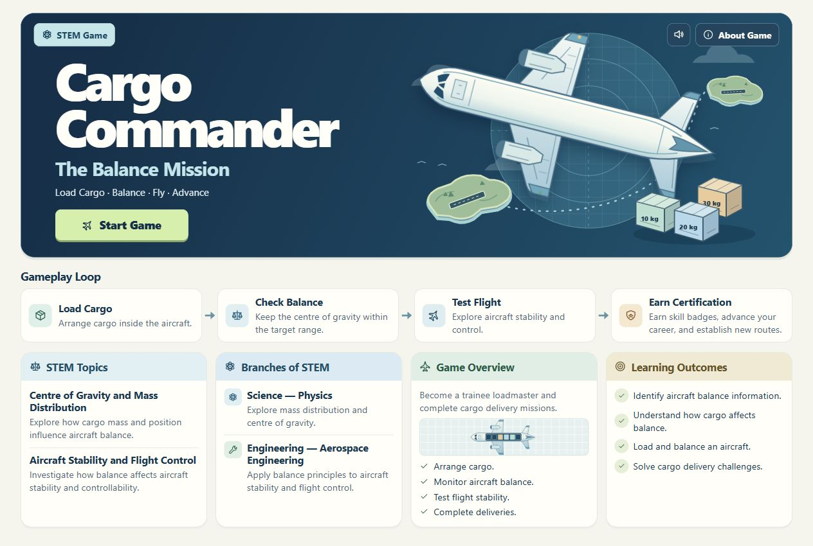
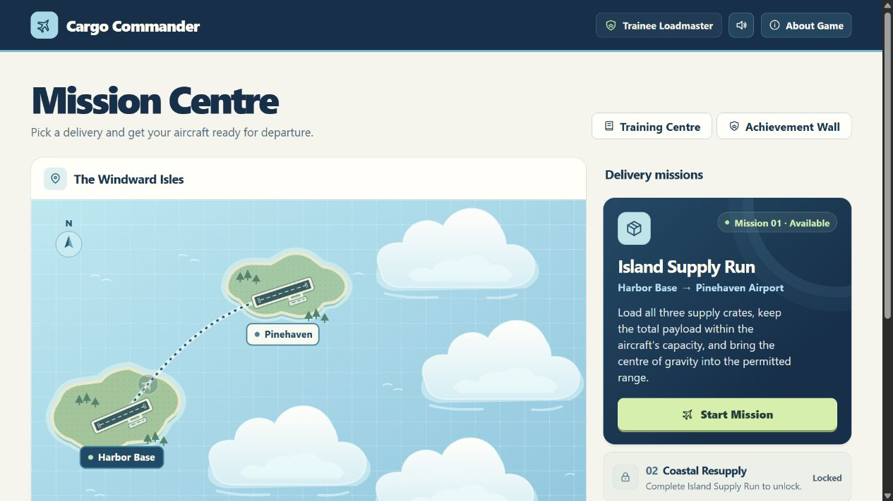
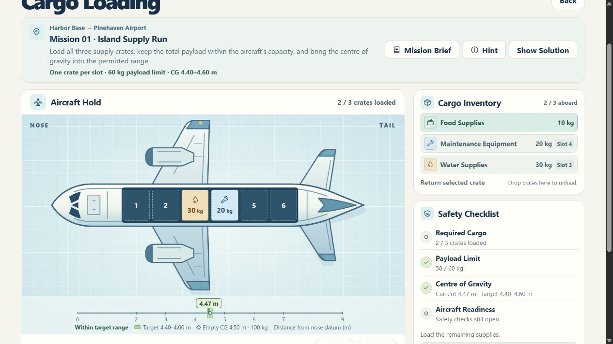
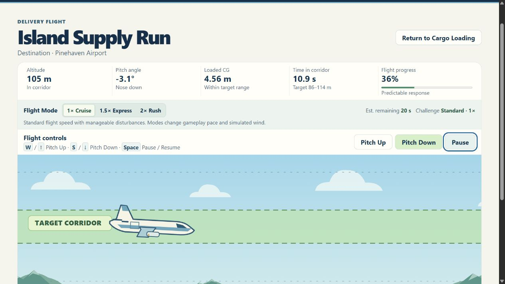
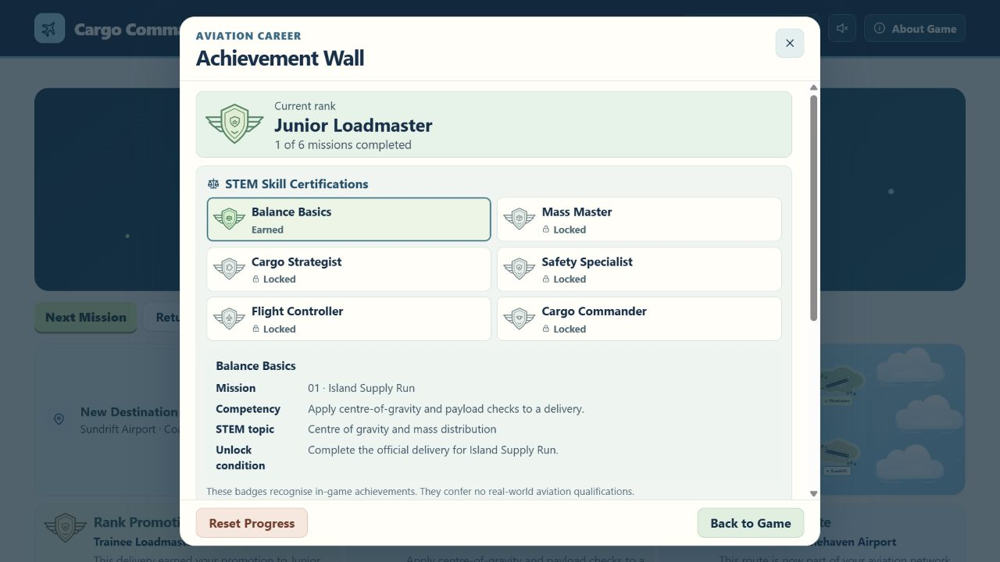
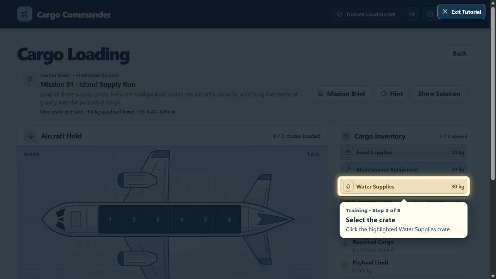
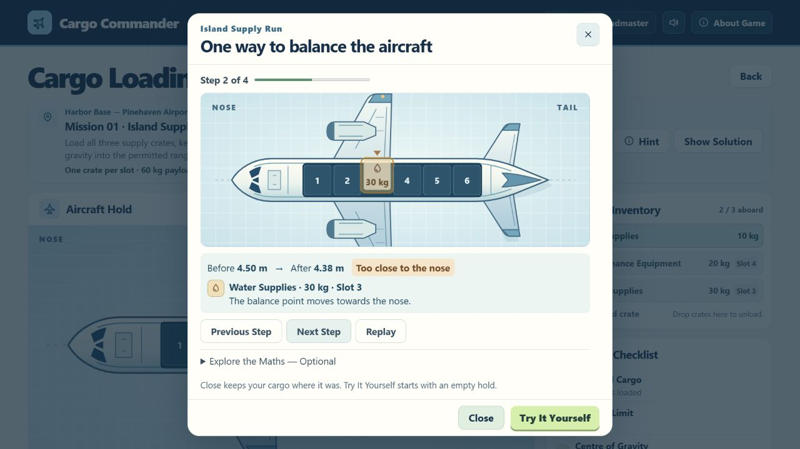
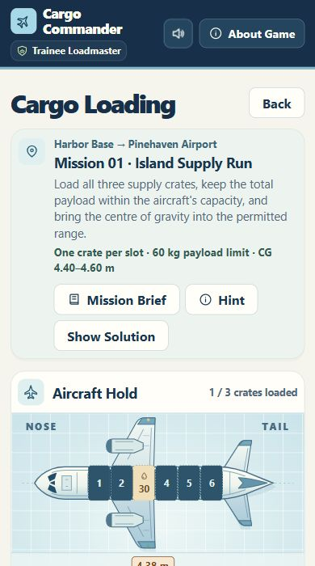

# CARGO COMMANDER — THE BALANCE MISSION

## [▶ PLAY CARGO COMMANDER](https://bruce666-ppp.github.io/IDAT7220FinalGame/)

Play directly in your browser — no installation required.  
Playable on desktop and mobile browsers. Compatibility checks are recorded in the [test report](TEST_REPORT.md).


Cargo Commander is an interactive STEM aviation game for learners new to physics and flight control. As a trainee loadmaster in the fictional Windward Isles, you position cargo, check the aircraft's balance, fly deliveries and connect island communities.

## STEM topics

| Topic | Branch and application |
| --- | --- |
| Centre of Gravity and Mass Distribution | **Science — Physics.** Observe how each crate's mass and distance from the nose change the balance point. |
| Aircraft Stability and Flight Control | **Engineering — Aerospace Engineering.** Investigate how cargo distribution affects simulated response to pitch inputs and gusts. |

### Learning objectives

1. **Explain how cargo mass and position influence an aircraft's centre of gravity.** Compare the CG shift when moving two different masses by the same distance.
2. **Arrange cargo to achieve a specified centre-of-gravity range.** Use the hold, manifest and live safety checklist to prepare a delivery.
3. **Analyse how different centre-of-gravity configurations affect aircraft stability and controllability.** Fly comparable loads in Practice and inspect the altitude traces, mode, elapsed time and corridor performance.
4. **Apply flight-test feedback to solve cargo-loading problems under given constraints.** Return to the hold after reviewing a flight, revise the load and test the result.

## From manifest to delivery

**Mission Briefing → Cargo Loading → Safety Inspection → Flight Challenge → Delivery → Learning Feedback → Career Progression**

The position of each crate affects the CG even when total mass stays fixed. A valid delivery needs the required cargo, permitted slots, a load within the payload limit and a CG within the target band. In flight, use small pitch corrections to reach the destination within the altitude and stability requirements.

| Mission | Route | Main challenge | Certification |
| --- | --- | --- | --- |
| 01 · Island Supply Run | Harbor Base → Pinehaven | Balance three differently weighted crates. | Balance Basics |
| 02 · Coastal Resupply | Harbor Base → Sundrift | Plan around the 50 kg replacement turbine. | Mass Master |
| 03 · Inter-Island Relay | Sundrift → Pinehaven | Redistribute cargo around two closed slots. | Cargo Strategist |
| 04 · Emergency Medical Delivery | Sundrift → Mercy Cay | Use a powered position for the Medical Case. | Safety Specialist |
| 05 · Flight Through the Gusts | Mercy Cay → Stormwatch | Maintain altitude in stronger simulated gusts. | Flight Controller |
| 06 · Operation Windward | Stormwatch → Northstar | Combine closed slots, special fittings, a tight payload and gusts. | Cargo Commander |

Successful official deliveries establish routes and clear clouds over later destinations. The Achievement Wall tracks the three parts of the **ABE reward system**.

- **A · Aviation career progression.** Advance from Trainee Loadmaster through the campaign ranks to Cargo Commander.
- **B · Aviation route network expansion.** Discover destinations and establish connections on the archipelago map.
- **E · STEM skill certifications.** Earn a mission-specific badge for each official delivery. These badges represent in-game achievements.

## Learning support

**Guided learning → Independent exploration → Progressive hints → Worked examples → Independent retry**

At first launch, beginners can follow a spotlight tutorial and experienced players can go directly to the Mission Centre. The Training Centre remains available later. Mission-specific instructor notes introduce special constraints. Manual and timed hints build from a conceptual reminder to a legal move. Each mission offers a step-by-step worked solution with plain-language explanations and optional maths.

Practice flights, live coaching, instructor demonstrations and flight reviews give players ways to test a change and try again. Using any of these supports carries no reward penalty. Official deliveries establish routes, ranks and certifications.

## Game design

The **goal** is to deliver supplies safely. The **rules** enforce the manifest, payload, permitted positions, CG and safe arrival. The **rewards** tie delivery success to career advancement, routes and skill badges. The **challenges** grow from simple balance decisions to restricted holds and stronger simulated gusts.

In the **MDA framework**, the loading and flight **mechanics** encourage the **dynamics** of planning, experimentation and correction. The illustrated islands, cloud reveals, simulated flight and delivery feedback support the intended **aesthetics** of discovery, challenge and achievement. [Read the educational and game design rationale.](GAME_DESIGN.md)

## Gameplay gallery

| Home | Mission Centre |
| --- | --- |
|  |  |
| The title, gameplay loop and STEM overview. | The Windward Isles and available deliveries. |
| **Cargo Loading** | **Flight Challenge** |
|  |  |
| Live balance and cargo checks as supplies move. | Simulated altitude, pitch and route progress. |
| **Achievement Wall** | **Spotlight Tutorial** |
|  |  |
| Career rank, certifications and completed deliveries. | A focused step in the beginner training. |
| **Worked Solution** | **Mobile Gameplay** |
|  |  |
| A worked example with before and after CG readings. | A 390 CSS-pixel browser viewport showing the wrapped title and enlarged cargo slots. |

## Controls

| Action | Desktop | Touch layout |
| --- | --- | --- |
| Select or place cargo | Drag a crate, or click it and then a slot. | Tap a crate, then tap a slot. |
| Remove cargo | Drag a loaded crate to the inventory, or select it and choose **Return selected crate**. | Tap a loaded crate, then tap **Return selected crate**. |
| Undo or clear the hold | **Undo** or **Reset** in Cargo Loading. | Same buttons. |
| Pitch up or down | Hold **W / ↑** or **S / ↓**, or hold the on-screen controls. | Hold **Pitch Up** or **Pitch Down**, then release. |
| Change flight mode | Select **Cruise**, **Express** or **Rush**. | Same buttons. |
| Pause or resume flight | **Space** or the on-screen flight button. | Tap **Pause** or **Resume**. |
| Get learning support | **Hint**, **Show Solution**, **Show Flight Demonstration** or **Training Centre**. | Same buttons. |
| Reset campaign | **Achievement Wall → Reset Progress**, then confirm. Audio preferences are kept. | Same controls. |

## Run locally

The project uses React, TypeScript, Vite, CSS, SVG, Web Audio API and browser-local storage. Use Node.js 24 and pnpm 11.

```sh
git clone https://github.com/Bruce666-ppp/IDAT7220FinalGame.git
cd IDAT7220FinalGame
pnpm install --frozen-lockfile
pnpm dev
pnpm test
pnpm build
pnpm exec vite preview
```

The development server normally opens at `http://localhost:5173/`. The production build is written to `dist/` and the preview normally serves it from `http://localhost:4173/IDAT7220FinalGame/`. The [GitHub Actions workflow](.github/workflows/deploy.yml) tests and builds `main` and deploys the artifact to GitHub Pages. The [test report](TEST_REPORT.md) records deployment verification.

## Educational simulation

Cargo Commander uses simplified educational models to demonstrate centre of gravity and aircraft stability. It is not intended for real-world aircraft loading, engineering certification or aviation flight training.

**Boyang Wan** · Individual STEM educational game  
**IDAT7220** · MSc(Eng) in Innovative Design and Technology  
**The University of Hong Kong**
