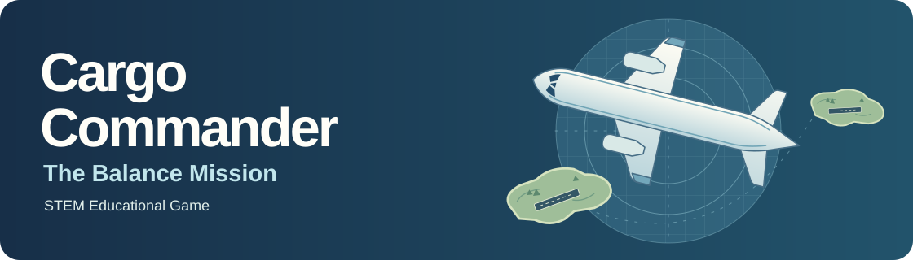
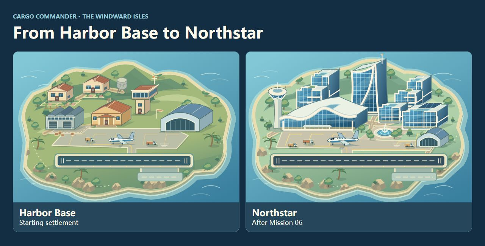
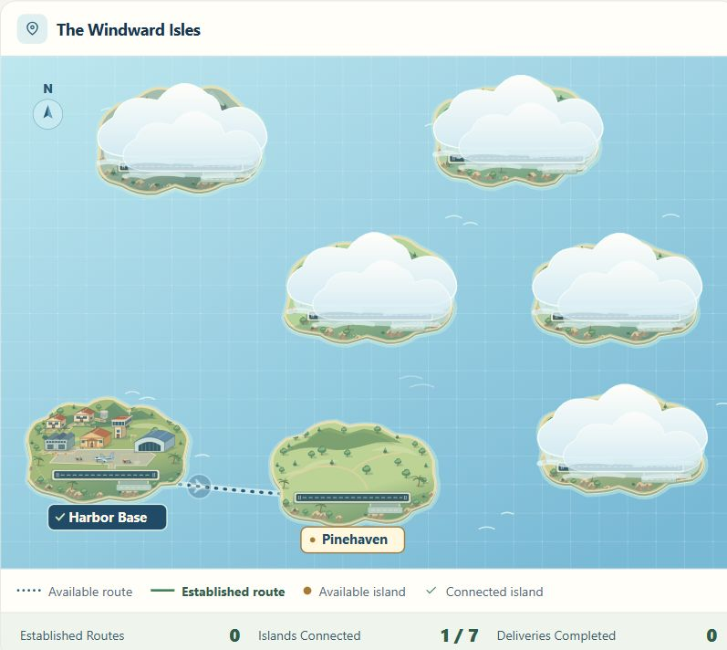
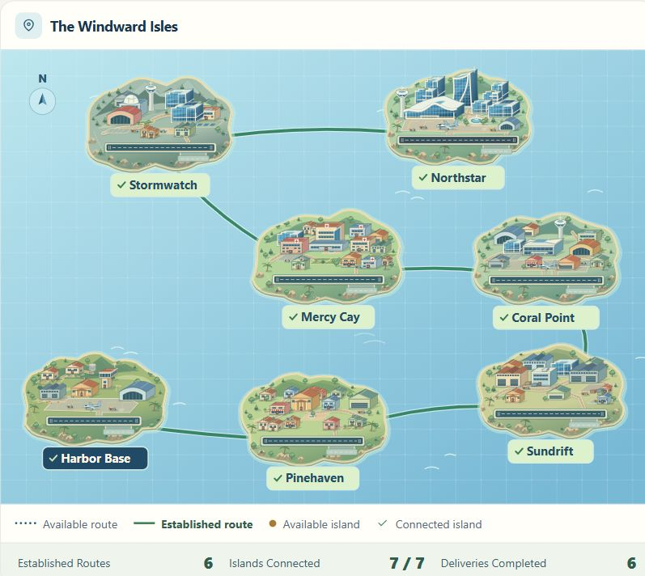
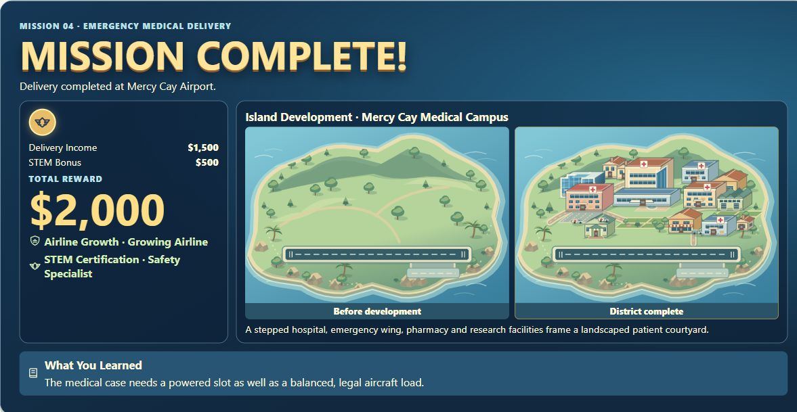
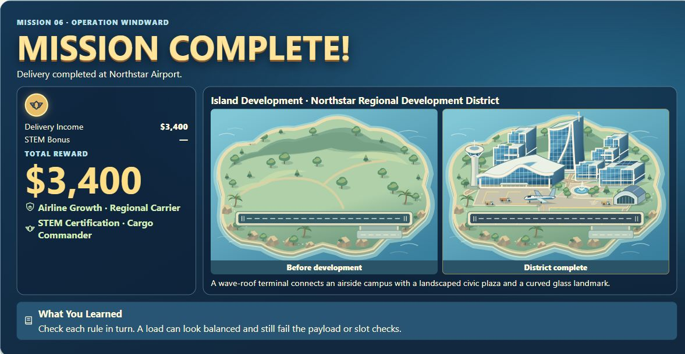

# CARGO COMMANDER — THE BALANCE MISSION

## [▶ PLAY CARGO COMMANDER](https://bruce666-ppp.github.io/IDAT7220FinalGame/)

Play directly in your browser — no installation required.  
Playable on desktop and mobile browsers. Compatibility checks are recorded in the [test report](TEST_REPORT.md).



Cargo Commander is an interactive STEM aviation game for learners new to physics and flight control. As a trainee loadmaster in the fictional Windward Isles, you position cargo, check the aircraft's balance, fly deliveries and connect island communities.

## STEM topics

| Topic | Branch and application |
| --- | --- |
| Centre of Gravity and Mass Distribution | **Science — Physics.** Observe how each crate's mass and distance from the nose change the balance point. |
| Aircraft Stability and Flight Control | **Engineering — Aerospace Engineering.** Investigate how cargo distribution affects simulated response to pitch inputs and gusts. |

### Learning Outcomes (ABCD Model)

1. **LO1 · Factual Knowledge — Identify Aircraft Balance Information.** By the end of the game, beginner STEM learners aged 10–14 will be able to identify cargo masses, the current centre of gravity and the permitted CG range using the cargo inventory and balance indicators, with all three types of information correctly identified.
2. **LO2 · Conceptual Knowledge — Explain Cargo Effects on Balance.** By the end of the game, beginner STEM learners aged 10–14 will be able to explain the effect of cargo movement on the centre of gravity through equal-distance comparisons at constant total loaded mass, with correct reasoning about the direction of movement and the greater effect of heavier cargo.
3. **LO3 · Procedural Knowledge — Arrange Cargo Safely.** By the end of the game, beginner STEM learners aged 10–14 will be able to arrange all required cargo using the loading interface and real-time CG feedback, with all applicable loading safety requirements satisfied.
4. **LO4 · Problem-Solving Knowledge — Select an Effective Delivery Strategy.** By the end of the game, beginner STEM learners aged 10–14 will be able to select an appropriate cargo-loading and flight strategy given mission-specific constraints and flight feedback, with all mission requirements satisfied and a successful delivery.
5. **LO5 · Creative Application — Design Your Own Cargo Mission.** By the end of the game, beginner STEM learners aged 10–14 will be able to design an original cargo delivery mission using DIY Mission Studio, with a valid reference solution, satisfaction of all selected constraints and a successful test flight.

The Home Page and About Game both show each complete sentence and its colour-coded **A · Audience**, **B · Behaviour**, **C · Condition** and **D · Degree**. [See the course alignment and assessment evidence.](GAME_DESIGN.md#constructive-alignment)

## From manifest to delivery

**Mission Briefing → STEM Decision → Cargo Loading → Safety Inspection → Flight Verification → Delivery and Island Development**

The position of each crate affects the CG even when total mass stays fixed. A valid delivery needs the required cargo, permitted slots, a load within the payload limit and a CG within the target band. **Auto Delivery** flies the actual loaded aircraft through the educational simulator and completes the mission automatically when the flight meets the delivery criteria. **Manual Delivery** uses W/S or touch controls and the original Cruise, Express and Rush options. Either mode completes the same mission and earns the same rewards. **Practice Flight** is available for experiments without campaign rewards.

| Mission | Route | STEM activity | Delivery | Optional STEM bonus | Certification |
| --- | --- | --- | ---: | ---: | --- |
| 01 · Island Supply Run | Harbor Base → Pinehaven | Read the current CG against the permitted range. | $400 | $100 | Balance Basics |
| 02 · Coastal Resupply | Pinehaven → Sundrift | Compare equal-distance moves of heavy and light cargo. | $600 | $200 | Mass Master |
| 03 · Inter-Island Relay | Sundrift → Coral Point | Record two distinct layouts around closed slots. | $900 | $300 | Cargo Strategist |
| 04 · Emergency Medical Delivery | Coral Point → Mercy Cay | Explain why the Medical Case needs a powered slot. | $1,500 | $500 | Safety Specialist |
| 05 · Flight Through the Gusts | Mercy Cay → Stormwatch | Interpret measured results from two controlled flights. | $2,200 | $800 | Flight Controller |
| 06 · Operation Windward | Stormwatch → Northstar | Compare strategies using payload, balance and cargo fittings. | $3,400 | $1,100 | Cargo Commander |

Successful official deliveries establish routes and clear clouds over later destinations. The Achievement Wall tracks the three parts of the **ABE reward system**.

- **A · Aviation career progression.** Advance from Trainee Loadmaster through the campaign ranks to Cargo Commander.
- **B · Aviation route network expansion.** Discover destinations and establish connections on the archipelago map.
- **E · STEM skill certifications.** Earn a mission-specific badge for each official delivery. These badges represent in-game achievements.

Harbor Base starts as a small aviation settlement with a runway, hangar and hillside cottages. Each first delivery develops a new district and establishes the next leg of the seven-island journey. The architecture progresses from Pinehaven’s pitched roofs through specialist campuses to Northstar’s glass towers, wave-roof terminal and landscaped plaza. Replay any completed route to earn a missed STEM Bonus. Campaign earnings reach $12,000. The first qualifying original mission adds $2,000, for a combined $14,000 in fictional game currency. **Airline Growth** tracks six earnings milestones. **Island Development** shows the six districts.

The construction sequence uses a locally bundled excerpt of the crowd cheering, clapping and calling out at the GameSoundCon 2024 Walla session. Recording and editing by Shane Vincent, uploaded as ShangusBurger under CC0 1.0. The game trims and filters the recording and schedules two bursts around construction. [Recording and licence](https://freesound.org/people/ShangusBurger/sounds/763932/)

## DIY Mission Studio

From the first visit to Mission Centre, open **DIY Mission Studio** and follow **Create → Solve → Explain → Test & Save**.

1. **Create** a challenge with a default two-crate manifest, editable masses and optional blocked positions. Use **Advanced Details** for a narrower CG target or simulated wind. Check that at least one legal loading arrangement exists.
2. **Solve** your challenge in Cargo Loading and select **Save Reference Solution** when the checks pass.
3. **Explain** by reviewing the worked example and its calculated balance. Add an optional Creator's Note and confirm the explanation.
4. **Test & Save** by testing that exact reference load with Auto Delivery or Manual Delivery, then save the validated mission.

In **My Missions**, revisit drafts and manage created or received missions. Open **Share → Copy Mission Link** on a validated mission to invite someone to solve it. The link opens the challenge in their browser. They can try another legal arrangement, use the creator's worked example when needed, and save the received mission locally. Receiving and playing a challenge leave official campaign progress independent.

The **Mission Architect** badge and one-time $2,000 creative reward recognise a completed original design with a meaningful constraint. It supports **Create** in Bloom's Taxonomy and is separate from career rank. The studio uses Mission 01's 60 kg payload and 4.40–4.60 m CG envelope as fixed educational simulation parameters.

## Learning support

**Guided learning → Independent exploration → Progressive hints → Worked examples → Independent retry**

At first launch, **Quick Beginner Training** takes players through **Place → Balance → Auto Delivery** and a sample island development scene. Experienced players can enter the Mission Centre directly. The **Training Centre** also offers the original **Complete Training** and all six individual modules for self-paced practice. Manual and timed hints build from a conceptual reminder to a legal move. Each campaign and saved custom mission offers a step-by-step worked solution with optional maths.

Practice flights, live coaching, instructor demonstrations and flight reviews give players ways to test a change and try again. Using any of these supports carries no reward penalty. Official deliveries establish routes, ranks and certifications.

## Game design

The **goal** is to deliver supplies safely and optionally design original challenges. The **rules** enforce the manifest, payload, permitted positions, CG and safe arrival. The **rewards** tie delivery success to ranks, routes and certifications, with Mission Architect recognising an eligible original design. The **challenges** span increasingly constrained official deliveries and custom problems shared by peers.

In the **MDA framework**, the loading and flight **mechanics** encourage the **dynamics** of planning, experimentation and correction. The illustrated islands, cloud reveals, simulated flight and delivery feedback support the intended **aesthetics** of discovery, challenge and achievement. [Read the educational and game design rationale.](GAME_DESIGN.md)

The [educational design notes](GAME_DESIGN.md#educational-frameworks) map the development process retrospectively to ADDIE and explain how the scenarios, iterative 5E activities, and Bloom's cognitive levels relate to those outcomes. In-game checks record task performance. The optional teacher questions in the design notes give learners a chance to explain their thinking aloud.

## Gameplay gallery



| Initial Harbor Base settlement | Completed seven-island network |
| --- | --- |
|  |  |
| **Mercy Cay Medical Campus** | **Northstar Regional Development District** |
|  |  |

- [Pinehaven supply district](docs/screenshots/phase753/pinehaven.jpg) and [Stormwatch weather and emergency district](docs/screenshots/phase753/stormwatch.jpg)
- Mercy Cay construction sequence. [Foundations](docs/screenshots/phase753/construction-foundations.jpg), [roads and services](docs/screenshots/phase753/construction-buildings.jpg), and [district opening](docs/screenshots/phase753/construction-complete.jpg).
- [Auto Delivery and Manual Delivery options](docs/screenshots/phase75-delivery-modes.jpg) and [controlled flight comparison](docs/screenshots/phase74-flight-comparison.jpg)
- [Home and the five ABCD outcomes](docs/screenshots/phase74-home.jpg), [About Game](docs/screenshots/phase74-about.jpg), [Training Centre](docs/screenshots/phase74-training-centre.jpg) and [DIY editor](docs/screenshots/phase74-diy-editor.jpg)

## Controls

| Action | Desktop | Touch layout |
| --- | --- | --- |
| Select or place cargo | Drag a crate, or click it and then a slot. | Tap a crate, then tap a slot. |
| Remove cargo | Drag a loaded crate to the inventory, or select it and choose **Return selected crate**. | Tap a loaded crate, then tap **Return selected crate**. |
| Undo or clear the hold | **Undo** or **Reset** in Cargo Loading. | Same buttons. |
| Pitch up or down | Hold **W / ↑** or **S / ↓**, or hold the on-screen controls. | Hold **Pitch Up** or **Pitch Down**, then release. |
| Change flight mode | Select **Cruise**, **Express** or **Rush**. | Same buttons. |
| Pause or resume flight | **Space** or the on-screen flight button. | Tap **Pause** or **Resume**. |
| Get learning support | **Hint**, **Show Solution**, **Show Flight Demonstration** or **Training Centre**. | Same buttons. |
| Reset campaign | **Achievement Wall → Reset Progress**, then confirm. Official earnings, districts, ranks, routes and certifications reset. DIY missions, Mission Architect, its creative reward and audio preferences are kept. | Same controls. |

## Run locally

The project uses React, TypeScript, Vite, CSS, SVG, Web Audio API and browser-local storage. Use Node.js 24 and pnpm 11.

```sh
git clone https://github.com/Bruce666-ppp/IDAT7220FinalGame.git
cd IDAT7220FinalGame
pnpm install --frozen-lockfile
pnpm dev
pnpm test
pnpm build
pnpm exec vite preview
```

The development server normally opens at `http://localhost:5173/`. The production build is written to `dist/` and the preview normally serves it from `http://localhost:4173/IDAT7220FinalGame/`. The [GitHub Actions workflow](.github/workflows/deploy.yml) tests and builds `main` and deploys the artefact to GitHub Pages. The [test report](TEST_REPORT.md) records deployment verification.

## Educational simulation

Cargo Commander uses simplified educational models to demonstrate centre of gravity and aircraft stability. It is not intended for real-world aircraft loading, engineering certification or aviation flight training.

**Boyang Wan** · Individual STEM educational game  
**IDAT7220** · MSc(Eng) in Innovative Design and Technology  
**The University of Hong Kong**
